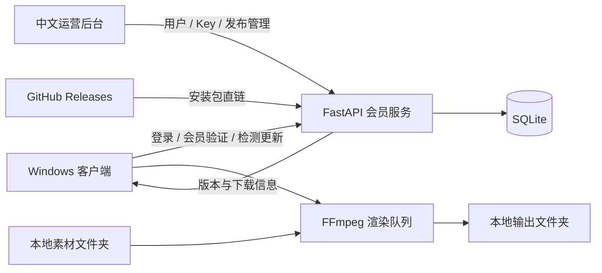

<div align="center">
  

  <p><strong>面向 Windows 的本地视频批量处理工具与会员运营系统</strong></p>
  <p>批量混剪 · 画面叠加 · 动态水印 · 渲染队列 · 设备绑定 · 在线更新</p>

  <p>
    
    
    
    
    
  </p>
</div>

---

## 项目简介

Video Mix Pro 将本地高性能视频处理客户端与可独立部署的会员后台组合在一个仓库中。客户端基于 Tauri、React、TypeScript 与 FFmpeg，负责扫描素材、生成任务和本地渲染；Docker 服务负责账号、会员、设备、兑换码与版本发布管理。

所有视频渲染均在用户本机完成，原始素材不需要上传到服务器。

## 主要功能

| Windows 客户端 | Docker 运营后台 |
| --- | --- |
| 按文件夹选择整批素材 | 用户分页、搜索与状态筛选 |
| 视频混剪、批量去重与多任务渲染队列 | 会员开通、撤销、封禁与批量操作 |
| 画面叠加、透明度和位置控制 | 单设备绑定、六小时换绑冷却与用户密码重置 |
| Logo 动态飘动水印 | Key 批次、过期、停用、恢复与导出 |
| 全局编码性能设置，自动识别 NVIDIA / AMD / Intel / CPU，并应用到全部生成任务 | 发布版本、GitHub 直链与更新说明管理 |
| 输出保持原素材名称 | 发布历史删改、官网四档定价、用户时间线与审计日志 |
| 安装版与解压即用便携版 | SQLite 自动迁移、备份和回滚流程 |

## 系统结构



## 快速开始

### Windows 客户端开发

准备 Node.js、npm 和 Rust 工具链，然后执行：

```powershell
git clone https://github.com/sanqixy-sudo/Video-Mix-Pro.git
cd Video-Mix-Pro\desktop

npm.cmd install
npm.cmd run download:ffmpeg
npm.cmd run tauri dev
```

生成中文 NSIS 安装包：

```powershell
npm.cmd run tauri build
```

FFmpeg 与 FFprobe 会放入 `desktop/src-tauri/bin/`，并随安装版和便携版一同分发。二进制文件不会提交到源码仓库。

### Docker 会员后台

```bash
cd server

export ADMIN_USER='your-admin-user'
export ADMIN_PASSWORD='replace-with-a-strong-password'
export ADMIN_TOKEN='replace-with-a-fixed-random-token-at-least-32-chars'

docker compose up -d --build
```

默认端口：

- 官网与 API：`http://SERVER_IP:57231`
- 中文管理后台：`http://SERVER_IP:57231/admin`
- 健康检查：`http://SERVER_IP:57231/api/health`

生产环境应配置 HTTPS 反向代理、明确的 CORS 来源和独立强密码。完整流程见 [Docker 更新与回滚说明](server/WEB_DOCKER_UPDATE.md)。

## 客户端更新流程

1. 修改客户端代码并同步递增所有客户端版本号。
2. 生成中文安装包和便携版，计算 SHA-256。
3. 在本仓库创建 GitHub Release 并上传安装包。
4. 复制 Release 的直接下载链接。
5. 登录运营后台，在“版本发布”填写版本号、GitHub 直链、更新说明与 SHA-256。
6. 客户端启动时及每 30 分钟比较一次本地版本、最新版本和最低支持版本。
7. 有普通更新时，左下角会员状态旁显示红点和“新版本”，点击后进入设置更新页。
8. 本地版本低于“最低支持版本”时，客户端显示不可关闭的强制更新弹窗；服务端登录、会话验证与兑换接口也会返回 `426 CLIENT_UPDATE_REQUIRED`，防止旧客户端绕过限制。

首次上线强制更新能力时，建议保持 `LEGACY_CLIENT_VERSION=0.2.0`，并让后台“最低支持版本”继续为 `0.2.0`。确认新版覆盖率后，再由管理员手动提高最低支持版本；提高后，低于该版本及未上报版本的老客户端会被要求更新。

只更新 Docker 官网时，仅递增 `SERVER_VERSION`，不要修改客户端 `APP_VERSION`，用户也不需要重新安装客户端。

## 项目目录

```text
Video-Mix-Pro/
├─ desktop/                 # Tauri + React Windows 客户端
│  ├─ src/                  # 页面、组件与前端逻辑
│  └─ src-tauri/            # Rust 命令、图标与安装器配置
├─ server/                  # FastAPI 官网、运营后台与 Docker 配置
│  ├─ static/               # 官网与后台静态资源
│  ├─ templates/            # HTML 模板
│  └─ tests/                # 服务端自动化测试
├─ scripts/                 # 品牌资源和交付打包脚本
├─ APP_IDENTITY.md          # 应用身份与刷机恢复档案
└─ README.md
```

## 文档导航

| 文档 | 用途 |
| --- | --- |
| [应用身份档案](APP_IDENTITY.md) | 保证后续安装包始终升级同一个应用，包含刷机恢复清单 |
| [客户端开发说明](desktop/README.md) | 客户端开发、Rust 与 FFmpeg 准备 |
| [便携版使用说明](desktop/便携版使用说明.txt) | 解压即用版本的操作说明 |
| [服务端部署说明](server/README.txt) | 会员服务、安全配置、迁移与验证 |
| [Docker 更新与回滚](server/WEB_DOCKER_UPDATE.md) | 服务器升级、备份、dry-run、smoke 和回滚 |

## 应用身份与版本延续

安装包能否被 Windows 识别为同一个应用，取决于固定的产品身份，而不是安装包文件名。本项目已将以下身份记录在 [APP_IDENTITY.md](APP_IDENTITY.md)：

- Tauri identifier：`com.videomix.pro`
- 产品名：`Video Mix Pro`
- Windows 安装模式：`perMachine`
- 安装器：中文 NSIS

除非明确发布全新产品，否则这些字段永久不要修改。

## 安全说明

- 不要提交 `.env`、数据库、管理员真实密码、Token、证书或私钥。
- `ADMIN_PASSWORD` 与 `ADMIN_TOKEN` 必须通过生产环境变量或 Secret 文件注入。
- Windows 代码签名证书应单独加密备份，禁止提交 GitHub。
- 发布安装包前应执行自动化测试、病毒扫描并核对 SHA-256。
- 生成的 EXE、便携版 ZIP 与 Docker 更新 ZIP 应上传到 GitHub Releases，不应提交到源码分支。

## 当前版本

- Windows 客户端：`0.2.1`
- Docker 官网与运营后台：`0.2.3`
- 设备换绑冷却：默认 `6` 小时

---

<div align="center">
  <sub>Video Mix Pro · Build locally, operate clearly.</sub>
</div>
